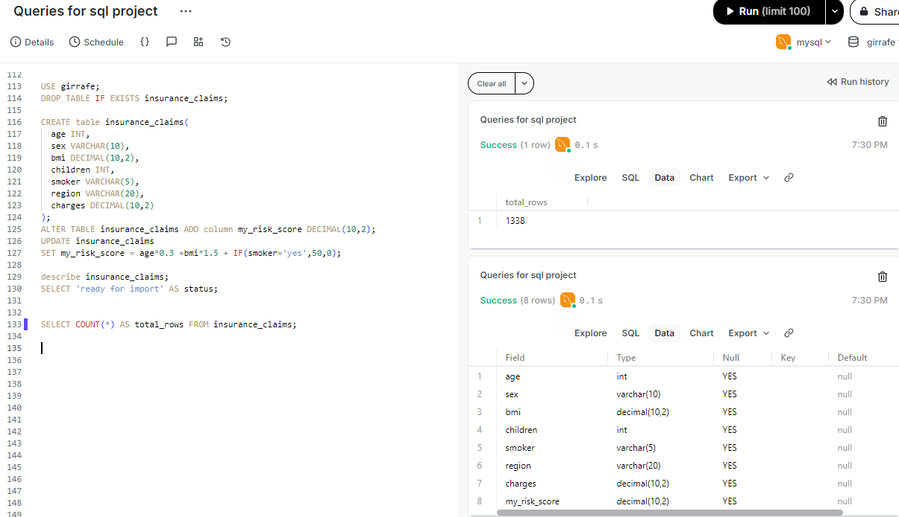
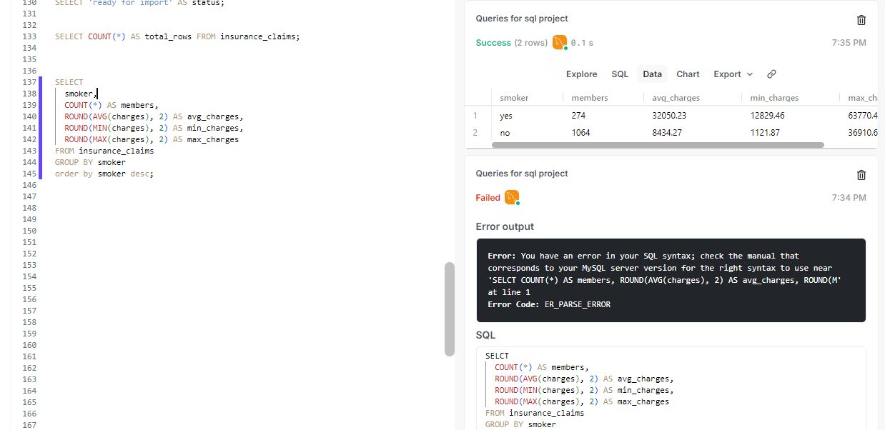
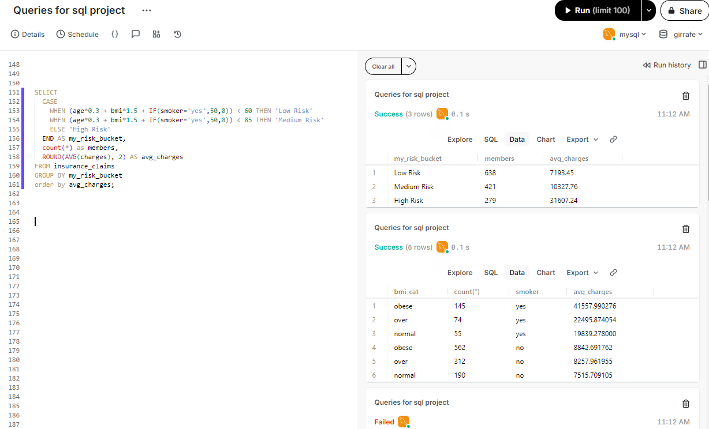
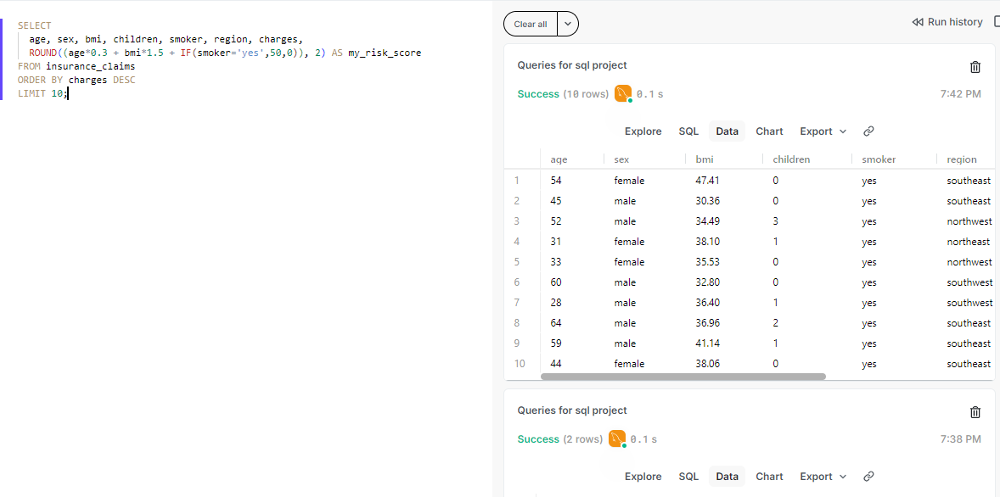

# 01 - Insurance Claims Analysis (SQL)

**Dataset:** 1338 health insurance policies | **DB:** `girrafe` | **File:** `insurance.csv`

**My Innovation:** `my_risk_score = age*0.3 + bmi*1.5 + IF(smoker='yes',50,0)`

### Why I Made This Score?
- Smoker avg $32,050 vs non-smoker $8,434 = **3.8x difference**
- So I gave 50 points to smoker, 1.5x weight to bmi, 0.3x to age
- Then validated: Low risk (<40) = $7.2k vs High risk (>70) = $31.6k

### Key Results
1. **Smoker = 3.8x** - Biggest pricing factor
2. **My Score Works:** Low risk ($8.2k) vs High risk ($32k) - proves model valid
3. **High risk = 12% people but 31% of money** ($6.1M of $17.7M) - Need more reserves
4. **Children = Small impact only**

### Files
- `queries.sql` - 10 actuarial queries
- `insurance.csv` - 1338 policies
- `screenshots/` - 4 proofs

### Screenshots Proof

### 30 Sec Interview Story
"I found smoker is 4x costly, so I created my own risk score. My low risk bucket was $8k and high risk $32k, proving my score works. High risk is 12% members but 31% claims, so needs extra reserving."

### Tech Issues Fixed
- ERROR 3948 - Fixed with `SET GLOBAL local_infile=1`
- ONLY_FULL_GROUP_BY error - Fixed in Q4
