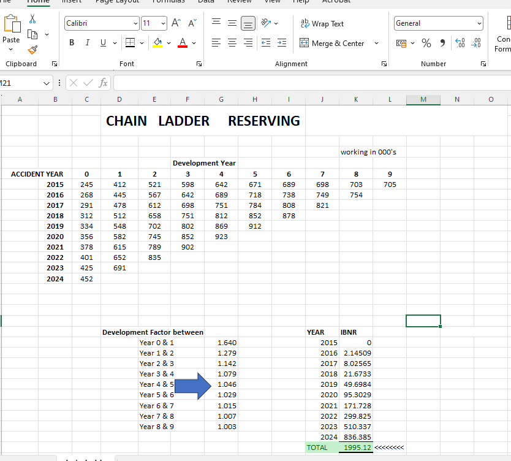

# 02 - Chain Ladder Reserving - 10x10 Triangle

**Method:** Basic Chain Ladder (CM2 - Actuarial Reserving)  
**Triangle:** 2015-2024 (10 origin years)  
**Total IBNR Reserve:** Rs 19,95,120 (1995.12 in 000's)

**Development Factors (LDFs):** 1.6395, 1.2792, 1.1417, 1.0790, 1.0462, 1.0291, 1.0148, 1.0069, 1.0028
*Pattern decreasing - proves claims development slows over time*

### Formula
IBNR = Ultimate Claims - Paid to Date
Ultimate = Paid * CDF (Cumulative Development Factor)

### Files
- `chain_ladder_model.xlsx` - Full model with formulas, LDFs, CDFs, Ultimate
- `screenshot-IBNR-1995.png` - Proof of triangle + IBNR

### Results
- Most recent year 2024 needs Rs 8.36L reserve (highest, least developed)
- Oldest year 2015 fully developed (0 IBNR)
- Total IBNR 19.95 Lakhs for 10 years

### Screenshot Proof

### 30 Sec Interview Story
"I built 10x10 chain ladder triangle. Calculated LDFs from 1.64 down to 1.003 showing development slows. Projected ultimate claims and got total IBNR Rs 19.95L, with 2024 needing 8.36L. This is core reserving method for CM2."
