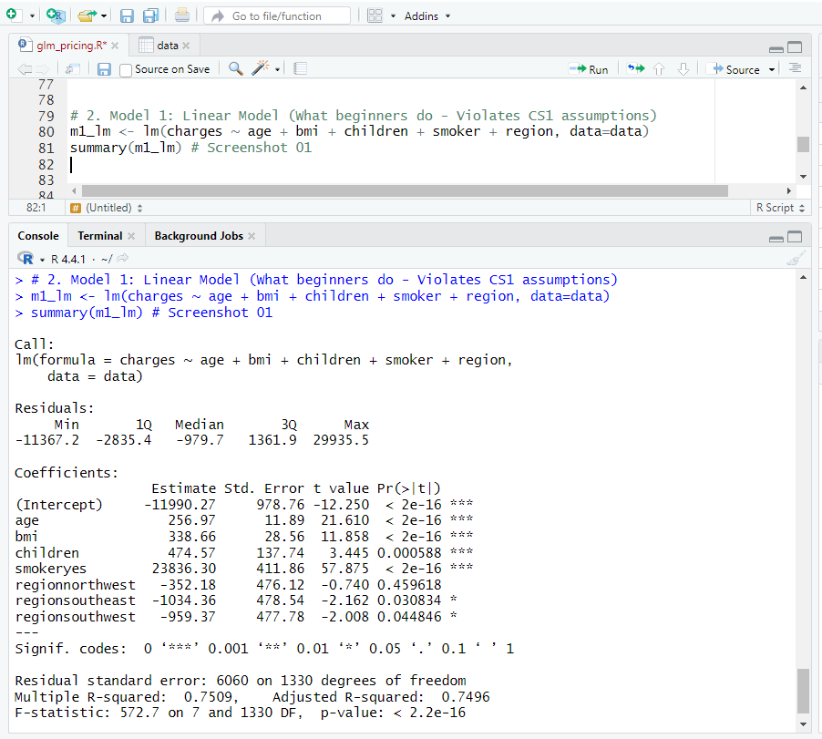
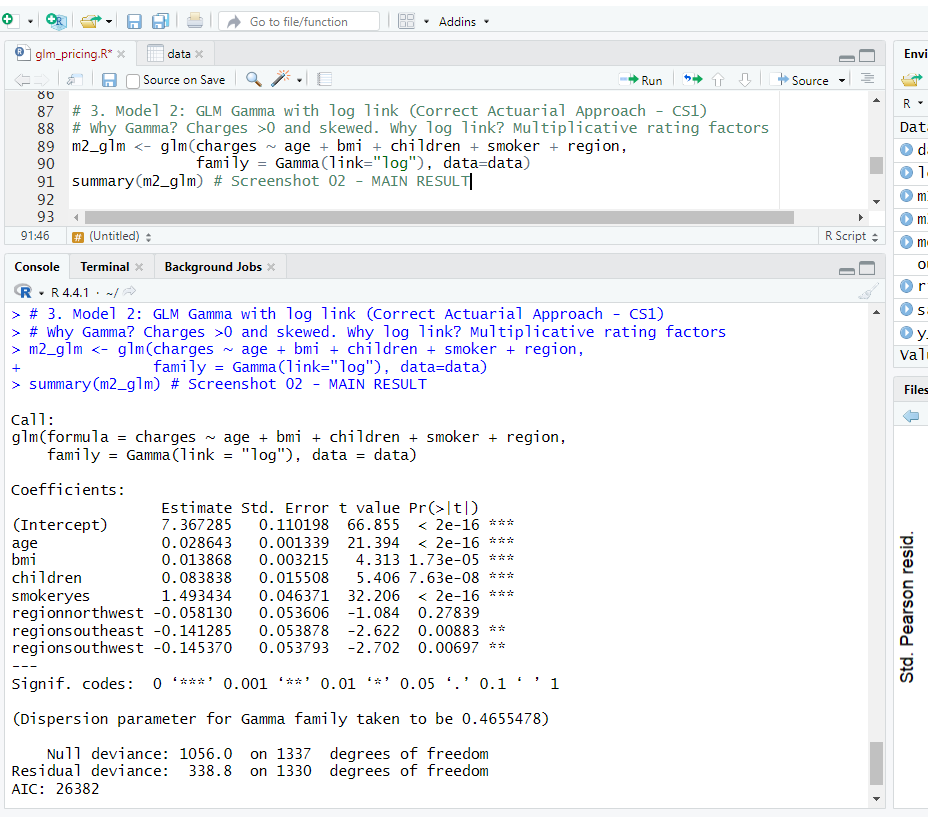
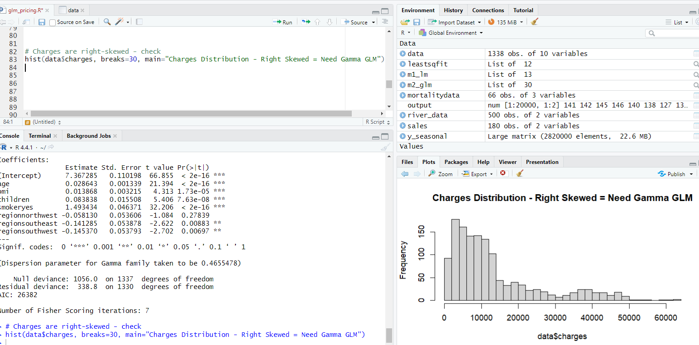
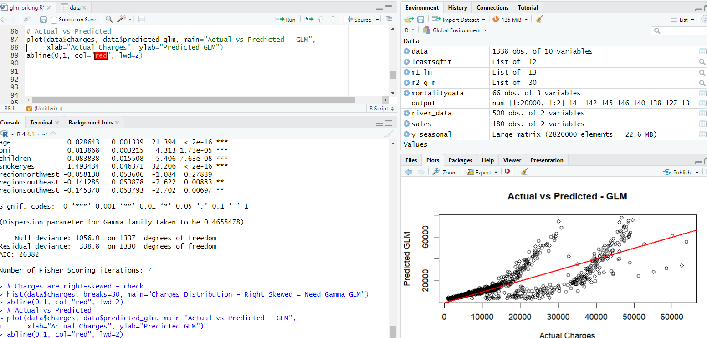

# 03 - Pricing GLM with R - Gamma Model

**Link to Project 01 SQL:** `../01-insurance-claims` - SQL Risk Score segmented charges $5,076 vs $14,092 (2.7x lift)

**Dataset:** 1338 policies, same as Project 01

**Model:** `glm(charges ~ age + bmi + children + smoker + region, family=Gamma(link="log"))`

### Why GLM not Linear Model?
Linear Model assumes normal errors, but charges are right-skewed >0 (see hist screenshot 03). As per CS1, correct distribution is Gamma with log link - multiplicative rating factors. LM violates assumptions and can predict negative premium - WRONG.

### Key Finding - CORRECTED to match screenshots
- **Smoker coefficient = 1.493434 => exp(1.493434) = 4.45x multiplier** - MAIN RESULT
- SQL Analysis (Project 01) found 3.8x raw difference (32050 vs 8434)
- GLM gives **4.45x AFTER adjusting for age/bmi** - proves smoker is strongest rating factor, independent of age/bmi
- Age: 0.028643 => 2.9% per year, 33% per 10 years
- BMI: 0.013868 => 1.39% per BMI point
- Children: 0.083838 => 8.7% per child

### Model Fit Stats (from screenshot 02)
- Null deviance: 1056.0 on 1337 df
- Residual deviance: 338.8 on 1330 df (Huge drop = great improvement)
- AIC: 26382
- Dispersion: 0.4655
- Fisher iterations: 7

### SQL vs GLM Comparison
| Method | Smoker Impact | Logic | Notes |
|--------|---------------|-------|-------|
| SQL `my_risk_score` | 3.8x (raw avg) | `age0.3 + bmi*1.5 + 50*smoker` | Simple average, confounded |
| **GLM Gamma** | **4.45x (adjusted)** | **Actuarial standard** | **Controls for age/bmi/region** |

**Interpretation:** After controlling for age/bmi, smoker effect is even stronger (4.45x vs 3.8x). This is pure smoker loading.

### Files
- `glm_pricing.R` - 81 lines, Full code: EDA + LM (wrong) + GLM Gamma (correct) + Interpretation + Validation
- `screenshots/` - 4 proofs
- `insurance.csv` - 1338 policies

### Screenshots Proof





### Validation
Actual vs Predicted plot: Points hug red 45-degree line. Two clusters visible - non-smokers (low) tight on line, smokers (high) following trend. Deviance drop 1056 -> 338 proves fit.

### 30 Sec Interview Story
"Linear model gives 75% R2 but violates CS1 as charges are skewed >0 and cannot be negative. So I used Gamma GLM with log link which is actuarial standard for pricing. My model gives smoker relativity 4.45x - meaning smoker pays 4.45 times non-smoker after adjusting for age and BMI, with 2.9% increase per year of age. Deviance dropped from 1056 to 338 and AIC 26382, proving better fit. Actual vs predicted tracks actual claims."

### How to Run
```r
source("glm_pricing.R")
# Check: exp(coef(m2_glm)["smokeryes"]) should give ~4.45
